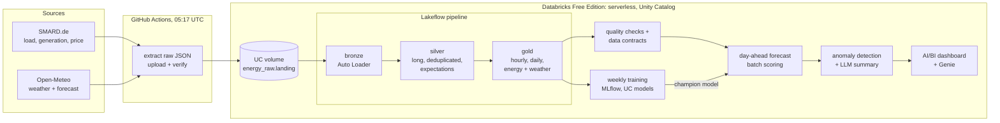
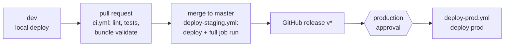

# energy-lakehouse-de

A daily-refreshed lakehouse for the German power market on Databricks: ingestion, data contracts,
day-ahead load and price forecasts, ML-assisted data quality, and a dashboard with natural-language
Q&A, deployed through dev → staging → prod.

[](https://github.com/tutul032/energy-lakehouse-de/actions/workflows/ci.yml)
[](https://github.com/tutul032/energy-lakehouse-de/actions/workflows/daily-refresh.yml)
[](https://github.com/tutul032/energy-lakehouse-de/actions/workflows/deploy-staging.yml)

## What it does

- **Ingests** German electricity load, generation by source and day-ahead prices (SMARD.de) plus
  hourly weather and weather forecasts (Open-Meteo) every day at 05:17 UTC.
- **Builds a medallion pipeline** (bronze → silver → gold) with data quality expectations, and
  enforces **data contracts** on the gold tables in CI and at runtime.
- **Forecasts** hourly load and day-ahead price for the next German calendar day, tracked in
  MLflow and promoted only if the model beats a seasonal-naive baseline. **ML-assisted data
  quality** flags anomalies with a severity design and an LLM-written daily summary.
- **Serves** the results in an AI/BI dashboard and a Genie agent for questions in plain English.

## Architecture





Each environment has its own schema (`energy_dev`, `energy_staging`, `energy_prod`); all of them
read the same raw files. Design decisions are recorded in [docs/adr/](docs/adr/).

## Results

| Metric | Model | Seasonal-naive baseline |
|---|---|---|
| Day-ahead load forecast, MAPE | **2.37 %** | 3.31 % |
| Day-ahead price forecast, MAE | **43.0 EUR/MWh** | 62.4 EUR/MWh |

- Baseline: the same hour one week earlier. Features use only data available at issue time
  (enforced by a leakage check).
- Genie agent: **6 / 6** benchmark questions answered with the expected SQL result.
- Data quality in prod: **0 critical** findings; warnings are ranked by score on the dashboard's
  *Data quality* page.
- Merit-order effect: the *Merit order* dashboard page plots the average night-time price (local
  00:00–05:59) against onshore wind speed at 100 m. Higher wind speeds come with lower prices.

<!--
Screenshots: add the files to docs/img/ and uncomment.


-->

## Tech stack

| Area | Tools |
|---|---|
| Platform | Databricks Free Edition (serverless), Unity Catalog, volumes |
| Ingestion | Python (`requests`) in GitHub Actions, Auto Loader |
| Transformation | Lakeflow Spark Declarative Pipelines (PySpark), expectations |
| Orchestration | Lakeflow Jobs, GitHub Actions (schedule, CI/CD) |
| Data contracts | YAML + pydantic, Unity Catalog comments, tags and grants |
| ML | scikit-learn (HistGradientBoosting, IsolationForest), MLflow, UC model registry |
| LLM | `ai_query` with a Foundation Model API endpoint (`databricks-gpt-oss-120b`) |
| BI | AI/BI dashboard, Genie |
| Deployment | Databricks Asset Bundles, Python wheel (hatchling, `uv build`) |
| Quality | pytest (offline, no Spark), ruff, test guards for config and environments |
| Tooling | uv, Python 3.12, Databricks CLI, Windows 11 / PowerShell |

## How to run it

Prerequisites: a Databricks Free Edition workspace, the Databricks CLI with a profile `free`, and
uv ([Lab 0](docs/tutorial/lab0-setup.md)).

```powershell
uv sync
uv run pytest
# One-time: create the shared landing volume (SQL editor):
#   CREATE SCHEMA IF NOT EXISTS workspace.energy_raw;
#   CREATE VOLUME IF NOT EXISTS workspace.energy_raw.landing;
uv run python -m energy_lakehouse.extract_local --out data/landing --weeks 8
.\scripts\sync_landing.ps1
uv run python scripts/build_dashboard.py
databricks bundle deploy -t dev -p free
databricks bundle run daily_refresh_job -t dev -p free
databricks bundle run train_forecast_job -t dev -p free
```

The full walkthrough is in the [tutorial](docs/tutorial/README.md); operations are in the
[runbook](docs/runbook.md).

## Data licences

- **SMARD.de** (Bundesnetzagentur): [CC BY 4.0](https://creativecommons.org/licenses/by/4.0/).
  Source: Bundesnetzagentur | SMARD.de.
- **Open-Meteo**: [CC BY 4.0](https://creativecommons.org/licenses/by/4.0/). Weather data by
  [Open-Meteo.com](https://open-meteo.com/).

Raw data is not stored in this repository; it is downloaded by the extractor.

## Engineering highlights

1. **Failed runs reported as success:** `databricks jobs run-now` exits 0 when the run fails, so
   the workflow checks `result_state` itself ([daily-refresh.yml](.github/workflows/daily-refresh.yml)).
2. **Late-published SMARD hours:** the newest chunks per series are always re-downloaded, and
   Auto Loader re-ingests overwritten files, with the newest file winning in silver
   ([smard.py](src/energy_lakehouse/smard.py), [ADR 0004](docs/adr/0004-long-silver-wide-gold.md)).
3. **Forecast leakage:** features are limited to data available at issue time (lags ≥ 48 h,
   weather forecasts issued before the run), and a violation raises `LeakageError`
   ([forecast.py](src/energy_lakehouse/forecast.py), [ADR 0007](docs/adr/0007-batch-scoring-not-model-serving.md)).
4. **Serverless library conflicts:** reinstalling runtime-provided packages broke Spark start-up,
   and environment v2 runs Python 3.11; a test guards every job environment, and the wheel
   targets 3.11 ([test_job_environments.py](tests/test_job_environments.py)).
5. **Three environments in one workspace:** resource name collisions (HTTP 409) were solved with
   per-target name prefixes and private bundle roots, and dashboard drift in prod is handled with
   an opt-in forced deploy ([ADR 0003](docs/adr/0003-shared-raw-zone-schema-per-environment.md),
   [runbook](docs/runbook.md#dashboard-modified-remotely)).

## Known limitations

- **No outbound internet on Free Edition:** extraction runs in GitHub Actions and uploads files
  to the volume ([ADR 0002](docs/adr/0002-extract-in-github-actions.md)). Ingestion depends on
  GitHub's scheduler, which can start runs late.
- **No account-level APIs on Free Edition:** no OIDC federation, so GitHub uses OAuth secrets of
  service principals that expire and must be rotated ([runbook](docs/runbook.md#secret-rotation)).
- **One workspace for dev, staging and prod:** environments are separated by schema, name prefix
  and permissions, not by workspace.
- **Training uses observed weather** as a stand-in for historical weather forecasts; scoring uses
  the issued forecast. Training accuracy can therefore be optimistic.
- **No backfill:** a missed daily run leaves that issue date without a forecast.
- **Genie agent is not a bundle resource:** it is recreated per environment from
  [docs/genie/](docs/genie/ask-the-energy-lakehouse.md).
- **No synthetic data:** all figures come from SMARD and Open-Meteo. The only injected value is a
  marked `TEST:` anomaly used to test detection in dev.

---

## For engineers

### CI/CD

```
pull request / push to master
  ci.yml               uv sync, ruff check, ruff format --check, pytest
                       databricks bundle validate -t staging / -t prod      (CI/CD SP)
        |
        v  merge to master (or Run workflow)
deploy-staging.yml     ci.yml (reused as gate) -> databricks bundle deploy -t staging
                       -> databricks bundle run daily_refresh_job -t staging (fails on FAILED run)
        |
        v  GitHub release published, tag v* (or Run workflow with a tag)
deploy-prod.yml        environment `production` (manual approval), checkout the tag
                       -> databricks bundle deploy -t prod -> databricks bundle summary -t prod
                       (Run workflow with `force`: deploy --force, see docs/runbook.md)
                       (no job run: daily-refresh.yml runs the prod job every day)
        |
        v  05:17 UTC daily
daily-refresh.yml      extract -> /Volumes/workspace/energy_raw/landing -> prod daily_refresh_job
```

| Target | Schema | Deployed by | Runs as |
|---|---|---|---|
| `dev` | `energy_dev` | you, locally (`-p free`) | your user |
| `staging` | `energy_staging` | `deploy-staging.yml` | CI/CD service principal |
| `prod` | `energy_prod` | `deploy-prod.yml` | CI/CD service principal |

All targets read raw files from the shared volume `/Volumes/workspace/energy_raw/landing` and
build their own tables in their own schema. Deploy auth is OAuth M2M for the CI/CD service
principal, no profiles: GitHub secrets `DATABRICKS_HOST`, `DATABRICKS_CICD_CLIENT_ID`,
`DATABRICKS_CICD_CLIENT_SECRET` are mapped to `DATABRICKS_HOST` / `DATABRICKS_CLIENT_ID` /
`DATABRICKS_CLIENT_SECRET`. Every deploy builds the `energy_lakehouse` wheel and installs it in the
job and pipeline environments.

Setup:
1. Fill `cicd_sp_app_id`, `refresh_sp_app_id` and `alert_email` for every target in
   `databricks.yml` (`tests/test_bundle_config.py` fails while `REPLACE_WITH_...` remains).
2. Add the secrets `DATABRICKS_CICD_CLIENT_ID` and `DATABRICKS_CICD_CLIENT_SECRET` (an OAuth
   secret of the CI/CD service principal).
3. Create the environment `production` (*Settings → Environments*) with *Required reviewers*.

### Daily refresh

```
GitHub Actions (.github/workflows/daily-refresh.yml)
  1. extract_local --source all       SMARD + Open-Meteo -> data/landing on the runner
  2. scripts/sync_landing.sh          databricks fs cp -r --overwrite -> /Volumes/workspace/energy_raw/landing
                                      + databricks fs ls verification per source
  3. databricks jobs run-now <id>     waits; workflow fails unless result_state == SUCCESS
  4. upload data/landing/logs         extractor log as a workflow artifact
        |
        v  service principal, OAuth M2M (client id + secret)
Databricks Free Edition: prod daily_refresh_job (serverless, no schedule)
  run_pipeline      energy_pipeline update (incremental, full_refresh: false)
  quality_checks    src/notebooks/03_quality_checks.py
                    - gold_energy_hourly max(hour_utc) at most 72 h old
                    - gold_energy_weather_hourly has weather in the last 7 days
                    - silver_energy_long and silver_weather_hourly not empty
  apply_contracts   src/notebooks/04_apply_contracts.py: comments, tags, grants from contracts/
  verify_contracts  src/notebooks/05_verify_contracts.py: schema, quality rules, freshness SLA
  score_forecast    src/notebooks/11_score_forecast.py: champion models -> gold_forecast_hourly
  forecast_accuracy src/notebooks/12_forecast_accuracy.py: gold_forecast_accuracy
  detect_anomalies  src/notebooks/20_detect_anomalies.py: gold_dq_anomalies, gold_dq_daily_summary
  dq_summary_llm    src/notebooks/21_dq_summary_llm.py: optional ai_query summary (runs always)
  on failure        email to ${var.alert_email}
```

Setup:

1. Create a service principal in the workspace (*Settings → Identity and access → Service
   principals*) and generate an OAuth secret for it.
2. Set `refresh_sp_app_id` (its application ID) and `alert_email` in `databricks.yml`; the prod
   job is deployed by `deploy-prod.yml` (the refresh SP gets `CAN_MANAGE_RUN` on it).
3. Grant the service principal access to the shared landing volume (SQL editor). All targets
   read raw files from this one volume; the CI/CD service principal (which runs the staging/prod
   pipelines) needs `READ VOLUME` on it too:
   ```sql
   GRANT USE CATALOG ON CATALOG workspace TO `<application-id>`;
   GRANT USE SCHEMA ON SCHEMA workspace.energy_raw TO `<application-id>`;
   GRANT READ VOLUME, WRITE VOLUME ON VOLUME workspace.energy_raw.landing TO `<application-id>`;
   ```
4. Find the prod job ID: `databricks bundle summary -t prod -p free` (or the summary printed at
   the end of `deploy-prod.yml`).
5. In GitHub (*Settings → Secrets and variables → Actions*) add the secrets `DATABRICKS_HOST`,
   `DATABRICKS_CLIENT_ID`, `DATABRICKS_CLIENT_SECRET` and the variable `DATABRICKS_JOB_ID`.
6. Run the workflow once via *Actions → daily-refresh → Run workflow*.

The job runs the pipeline as its owner (the CI/CD service principal in prod); the refresh service
principal only needs `CAN_MANAGE_RUN` on the job (set by the bundle) plus the volume grants above.

### Data products

Each consumed table is a data product with a contract in [`contracts/`](contracts/) (schema,
grain, owner, freshness SLA, quality rules, tags, consumer groups). The product pages are
generated from the contracts:

| Data product | Table | Contract |
|---|---|---|
| [Energy market, hourly](docs/data-products/gold_energy_hourly.md) | `gold_energy_hourly` | [`gold_energy_hourly.yaml`](contracts/gold_energy_hourly.yaml) |
| [Energy market, daily](docs/data-products/gold_energy_daily.md) | `gold_energy_daily` | [`gold_energy_daily.yaml`](contracts/gold_energy_daily.yaml) |
| [Energy + weather, hourly](docs/data-products/gold_energy_weather_hourly.md) | `gold_energy_weather_hourly` | [`gold_energy_weather_hourly.yaml`](contracts/gold_energy_weather_hourly.yaml) |
| [Weather forecast, hourly](docs/data-products/gold_weather_forecast_hourly.md) | `gold_weather_forecast_hourly` | [`gold_weather_forecast_hourly.yaml`](contracts/gold_weather_forecast_hourly.yaml) |
| [Weather forecast per location](docs/data-products/silver_weather_forecast_hourly.md) | `silver_weather_forecast_hourly` | [`silver_weather_forecast_hourly.yaml`](contracts/silver_weather_forecast_hourly.yaml) |
| [Day-ahead forecast](docs/data-products/gold_forecast_hourly.md) | `gold_forecast_hourly` | [`gold_forecast_hourly.yaml`](contracts/gold_forecast_hourly.yaml) |
| [Forecast accuracy](docs/data-products/gold_forecast_accuracy.md) | `gold_forecast_accuracy` | [`gold_forecast_accuracy.yaml`](contracts/gold_forecast_accuracy.yaml) |
| [Data quality anomalies](docs/data-products/gold_dq_anomalies.md) | `gold_dq_anomalies` | [`gold_dq_anomalies.yaml`](contracts/gold_dq_anomalies.yaml) |
| [Data quality daily summary](docs/data-products/gold_dq_daily_summary.md) | `gold_dq_daily_summary` | [`gold_dq_daily_summary.yaml`](contracts/gold_dq_daily_summary.yaml) |

After every refresh, `daily_refresh_job` applies each active contract (`apply_contracts`:
comments, tags, `GRANT SELECT` to the consumer groups) and verifies it (`verify_contracts`:
columns and types via `information_schema`, quality rules, freshness); a violation fails the job.
Contracts with `status: draft` are skipped until their tables have data.

**Changing a contract:** edit `contracts/<table>.yaml` in a pull request, bump `version`
(semver) and regenerate the pages with `uv run python scripts/render_contract_docs.py`.

| Change | Version bump |
|---|---|
| Remove or rename a column, change a column type | MAJOR (`1.4.2` → `2.0.0`) |
| Add a column | MINOR (`1.4.2` → `1.5.0`) |
| Descriptions, quality rules, tags, SLA wording | PATCH (`1.4.2` → `1.4.3`) |

The column lists live in `src/energy_lakehouse/transforms.py`; `tests/test_contracts.py` fails if
a contract and the pipeline disagree on columns, types or descriptions, so a pipeline change
cannot silently break consumers.

### More

- [Architecture decision records](docs/adr/)
- [Runbook](docs/runbook.md)
- [Tutorial](docs/tutorial/README.md)
- [Changelog](CHANGELOG.md)
- [Genie agent definition](docs/genie/ask-the-energy-lakehouse.md)
