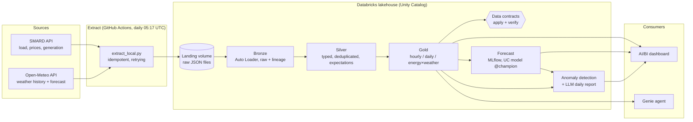
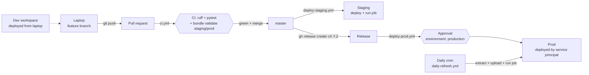

# Part I — Foundations

## Chapter 1 — The two architectures, box by box

Every project in this handbook has **two architectures**. Draw both **before** you write any code:

1. The **data/product architecture:** *where does data come from, what happens to it, who uses the result?*
2. The **delivery (CI/CD) architecture:** *how does a change get from my laptop into production safely?*

If you can't draw them, you're not ready to start. That's a feature, not a failure: the drawing forces the important decisions early.

### 1.1 The data/product architecture



**Each box, its job, and the lab that builds it:**

| Box | Job in one sentence | Built in | Key idea |
| --- | --- | --- | --- |
| **Sources** | Where the facts come from | Lab 1, 3 | Know the API's shape, update frequency and licence |
| **Extract** | Copy raw data reliably, without changing it | Lab 1, 3, 4 | **Idempotent** (rerun = no duplicates), **retrying**, testable offline |
| **Landing volume** | A folder of raw files, the unchanged record | Lab 1, 5 | Shared raw zone for all environments |
| **Bronze** | Raw data as a table, plus *where it came from* | Lab 2 | **Auto Loader** reads only new files; lineage columns |
| **Silver** | Clean, typed, one row per fact, quality rules | Lab 2, 3 | Deduplicate ("newest file wins"), **null-safe expectations** |
| **Gold** | Business-ready tables, the "data products" | Lab 2, 3, 9 | Aggregates per hour/day, KPIs, completeness |
| **Contracts** | The promise about each gold table, checked | Lab 6 | Schema, rules, SLA, owner; CI guard + runtime verify |
| **Forecast** | Predict tomorrow | Lab 7 | Leakage-safe features, baseline, champion alias |
| **Anomaly detection** | Find "possible but suspicious" data | Lab 8 | Severity: *unusual* ≠ *broken* |
| **Dashboard / Genie** | Make results visible and askable | Lab 9 | Dashboard as code; Genie with instructions + benchmarks |

**Read the diagram left to right as a story:** *"Every morning, GitHub Actions downloads the newest market and weather data into a landing folder. Databricks turns those files into clean tables, checks them against written promises, forecasts tomorrow, looks for anything suspicious, and updates a dashboard and an AI assistant."* If you can tell your project's story in two sentences like that, the architecture is right.

### 1.2 The delivery (CI/CD) architecture



| Box | Job | Who acts | Guard |
| --- | --- | --- | --- |
| **Feature branch** | Where you change things | You + Claude Code | Pre-commit hook refuses commits on `master` |
| **Dev workspace** | Your playground on Databricks | You (`bundle deploy -t dev`) | Resources prefixed `[dev <you>]` |
| **Pull request** | Proposal to change master | You | Ruleset: no direct pushes, CI must pass |
| **CI** | Lint, tests, validate config for staging and prod | GitHub Actions | Guard tests (placeholders, secrets, environments, dashboards…) |
| **master** | The truth | Merge only | Branch protection |
| **Staging** | Production-like test of every merged change | `deploy-staging.yml`, as the CI/CD service principal | Job run must be green |
| **Release** | A named version for prod | You (`gh release create`) | Only after merge + green staging |
| **Approval** | A human says "yes" | You | GitHub environment `production` |
| **Prod** | What users see | `deploy-prod.yml`, as the service principal | Nobody edits prod by hand |
| **Daily refresh** | Fresh data every morning | Cron, refresh service principal | Fails loudly, emails you |

**The story:** *"I change code on a branch. CI checks it. After merge it's automatically tested in staging. When I publish a release and approve it, a service principal deploys it to prod. Every morning a scheduled workflow feeds prod with new data."*

### 1.3 Where each lab sits in both architectures

| Lab | Data/product architecture | CI/CD architecture |
| --- | --- | --- |
| 0 | — (empty skeleton) | Repo, bundle, first CI |
| 1 | Sources → Extract → Landing | — |
| 2 | Bronze → Silver → Gold | Deploy dev |
| 3 | Second source (weather) → Gold join | Sync script |
| 4 | — | Daily refresh, service principal, job |
| 5 | Shared raw zone | PR → staging → release → prod, ruleset |
| 6 | Contracts | Breaking-change guard in CI |
| 7 | Forecast | Train job, model registry |
| 8 | Anomaly detection, LLM report | Severity → alerting |
| 9 | Dashboard, Genie | Dashboard as code |
| 10 | Docs | Wheel packaging, clean release |

### 1.4 How to draw your own architecture (before a new project)

1. **Write the two-sentence story** (see 1.1).
2. **List sources:** format, size, frequency, licence, access (API? files? database?).
3. **Name the gold tables** the users need. Work backwards from the dashboard or decision.
4. **Draw boxes left to right:** sources → extract → raw → bronze → silver → gold → consumers.
5. **Add optional layers only if needed:** contracts (others consume it), ML (prediction needed), monitoring (runs unattended).
6. **Draw the delivery path:** branch → PR → CI → staging → release → prod.
7. **Mark identities:** who runs what (you, CI service principal, refresh service principal).
8. Put both diagrams as **Mermaid** in the README from day one. They're text, so they live in Git and render on GitHub.

**Claude prompt to start:**

```text
Here is my project idea: <two-sentence story>. Sources: <list>. Users need: <gold outputs>.
Draw two Mermaid diagrams: (1) data/product architecture from sources to consumers using bronze/silver/gold,
(2) delivery architecture dev → PR/CI → staging → release + approval → prod.
For each box, write one sentence on its job. Ask me up to 5 questions about anything unclear. No code yet.
```

---

## Chapter 2 — Glossary for complete beginners

Read this once; come back when a term appears.

### Data and storage

| Term | Meaning |
| --- | --- |
| **Dataset** | A collection of data, e.g. hourly electricity prices |
| **Row / record** | One entry. **Grain** = what one row represents ("one hour", "one transaction") |
| **Primary key** | Column(s) that make a row unique (e.g. `hour_utc`) |
| **Schema** (two meanings) | (1) The structure of a table (columns + types). (2) In Unity Catalog, a folder of tables (`energy_prod`). |
| **Catalog** | Top level in Unity Catalog (`workspace`). Full table name: `catalog.schema.table` |
| **Volume** | A Unity Catalog folder for **files** (not tables), e.g. raw JSON |
| **Delta table** | The table format on Databricks: transactions, history, `MERGE` |
| **Lakehouse** | Files in cheap storage + table features (Delta) + governance (Unity Catalog) |
| **Medallion** | Bronze (raw) → Silver (clean) → Gold (business-ready) |
| **Long vs. wide** | Long: `(series, time, value)` rows. Wide: one column per series. |
| **Idempotent** | Running twice gives the same result as once (no duplicates) |
| **Lineage** | Where a row came from (source file, load time) |
| **UTC / local time** | UTC = universal time; business dates are local (Europe/Berlin). DST days have 23 or 25 hours. |

### Processing

| Term | Meaning |
| --- | --- |
| **Spark** | Distributed processing engine behind Databricks |
| **Serverless** | Compute you don't manage; it starts when needed |
| **Auto Loader** | Reads only **new** files from a folder; remembers progress in a **checkpoint** |
| **Lakeflow (Spark) Declarative Pipeline** | You declare tables and how they're computed; Databricks runs them in order |
| **Streaming table** | Processes only new input since the last run (used for bronze) |
| **Materialized view** | A table kept up to date with its inputs (silver, gold) |
| **Expectation** | A quality rule in a pipeline: warn, drop or fail |
| **Lakeflow Job** | A sequence of tasks with dependencies, retries and notifications |
| **Task environment** | The Python packages installed for a serverless job task |
| **Wheel (`.whl`)** | A packaged, versioned Python library |

### Quality and governance

| Term | Meaning |
| --- | --- |
| **Unity Catalog (UC)** | Governance: permissions, ownership, lineage, tags |
| **Grant** | A permission (`GRANT SELECT ON TABLE … TO group`) |
| **Data contract** | Machine-readable promise: schema, owner, rules, SLA, consumers |
| **SLA** | Service level agreement, e.g. "data at most 72 h old" |
| **Data product** | Table + contract + owner + docs + access |
| **Anomaly** | A value that is unusual compared with what's normal |
| **Severity** | How bad a finding is: *warning* (unusual) vs. *critical* (likely error) |
| **Alert fatigue** | Too many alerts, so people ignore them |

### ML

| Term | Meaning |
| --- | --- |
| **Feature** | An input to a model (hour of day, lag, wind speed) |
| **Target** | What the model predicts (load, price) |
| **Baseline** | A simple method the model must beat ("same hour last week") |
| **Leakage** | Using information you wouldn't have at prediction time |
| **Train/test split** | Fit on older data, evaluate on newer. Never shuffle time series. |
| **MAE / MAPE** | Average absolute error / average percentage error |
| **MLflow** | Tracks experiments, metrics and models |
| **Model registry / alias** | Versions of a model; `@champion` marks the one in use |
| **Batch scoring vs. serving** | Score on a schedule vs. answer requests in real time |
| **Drift** | Data or model quality changing over time |

### GenAI

| Term | Meaning |
| --- | --- |
| **LLM** | Large language model |
| **Foundation model endpoint** | A hosted LLM you call (e.g. with `ai_query`) |
| **Genie** | Natural-language questions → SQL over your tables |
| **RAG** | Retrieval-augmented generation: find relevant documents, then answer with them |
| **Agent / tool** | An LLM that can call functions (e.g. run SQL) |
| **Benchmark** | Questions with known answers, used to test an AI system |

### Delivery (CI/CD)

| Term | Meaning |
| --- | --- |
| **Git / branch / commit** | Version control / parallel line of work / saved change |
| **Pull request (PR)** | Proposal to merge a branch, reviewed and checked |
| **CI** | Automatic checks on every change |
| **CD** | Automatic deployment (staging always, prod after approval) |
| **Environment (dev/staging/prod)** | Separate copies: playground / test / real |
| **Databricks Asset Bundle** | Project definition (`databricks.yml`) for jobs, pipelines, dashboards per environment |
| **Service principal (SP)** | A non-human identity for automation |
| **OAuth secret / OIDC** | Stored credential / token exchange without stored secrets |
| **Release / tag** | A named version (`v1.0.0`) |
| **Ruleset / branch protection** | Rules that block direct pushes and require CI |
| **Pre-commit hook** | A check that runs before Git accepts a commit |
| **Guard test** | A test that prevents a known mistake from happening again |
| **Runbook** | Instructions for operating and fixing the system |
| **ADR** | Architecture decision record: decision, reason, consequences |

---

## Chapter 3 — The lab lifecycle: how every lab starts and ends

Every lab, every feature, every fix follows the **same loop**. Learn it until it's automatic. Most real problems in this project came from skipping a step.

```
 START                          BUILD                          VERIFY                     DELIVER                       FINISH
 ─────                          ─────                          ──────                     ───────                       ──────
 1 sync master                  4 plan with Claude             7 local checks             10 PR + CI                    14 verify prod
 2 branch                       5 implement + tests            8 deploy dev + run         11 merge → staging            15 tutorial + tag
 3 state goal + checkpoint      6 "test the test"              9 plausibility SQL         12 release → approve → prod   16 update roadmap
                                                                                          13 prod run (+retrain if needed)
```

### Step by step, with the fixed commands

**START**

```powershell
# 1. sync (only if the working tree is clean!)
git status --short | Measure-Object                     # must be 0
git switch master ; git fetch origin ; git reset --hard origin/master
# 2. branch
git switch -c feat/<short-name>
```

3. **Write down the goal and the checkpoint** before building: *"Done when the forecast table has 24 rows per target for tomorrow, and the model beats the baseline."*

**BUILD**

4. **Plan with Claude**, using the prompt pattern from Chapter 5 and ideally Claude Code's plan mode. Approve the plan.
5. **Implement:** Claude Code writes code and tests.
6. **Test the test:** break something on purpose and make sure a test fails.

```powershell
git add -A ; git commit -m "wip: <name>" ; git log --oneline -1   # commit BEFORE experimenting
```

**VERIFY**

```powershell
# 7. local checks
uv run ruff check . ; uv run ruff format --check . ; uv run pytest -q
# 8. deploy dev + run
databricks bundle validate -t dev -p free
databricks bundle deploy -t dev -p free
databricks bundle run <job-or-pipeline> -t dev -p free
```

9. **Plausibility SQL:** counts per layer, KPI ranges, and comparison with the source (Chapter 7 has templates).

**DELIVER**

```powershell
# 10. commit (verified), push, PR
git add -A ; git commit -m "feat: <name>" ; git log --oneline -1 ; git status --short | Measure-Object
git push -u origin HEAD ; gh pr create --fill --base master
gh pr checks --watch                                    # wait ~10 s after push
# 11. merge → staging
gh pr merge --squash --delete-branch
git switch master ; git fetch origin ; git reset --hard origin/master
gh run list --workflow deploy-staging.yml --limit 1     # ✓
# 12. release (only after merge + green staging)
git --no-pager ls-tree -r --name-only origin/master | Select-String "<a file from the PR>"
gh release create vX.Y.Z --target master --generate-notes --title "vX.Y.Z - <name>"
# → browser: approve deployment → ✓
# 13. prod run (always after table/schema/environment changes; retrain if environments changed)
gh workflow run daily-refresh.yml ; gh run watch
```

**FINISH**

14. **Verify prod** with the same plausibility SQL as step 9, now against `energy_prod`.
15. **Write the tutorial**, including every real problem with its log and fix. Then tag:

```powershell
git tag labN-complete origin/master ; git push origin labN-complete
```

16. **Update the roadmap** (the project handoff file), so the next session knows the state.

### Versioning rule (semantic versioning)

| Change | Version |
| --- | --- |
| Breaking (renamed column, removed table) | **MAJOR** (1.0.0 → 2.0.0) |
| New feature, compatible | **MINOR** (0.4.0 → 0.5.0) |
| Fix | **PATCH** (0.6.0 → 0.6.1) |

Releases are history: **fix forward** with a new version. Delete a release only if it's minutes old and nothing depends on it.

### Exam questions — Part I

1. **Why draw two architectures instead of one?**
   *Answer:* they answer different questions: *how data flows* and *how changes are delivered*. A system can have a perfect data flow and still be dangerous to change.
2. **What's the difference between bronze and silver?**
   *Answer:* bronze is raw plus lineage; silver is cleaned, typed, deduplicated and checked by quality rules.
3. **Why is `master` protected?**
   *Answer:* so every change passes CI and review, and prod is always built from checked code.
4. **What does "idempotent" mean, and why does it matter for extraction?**
   *Answer:* running twice gives the same result. Retries and reruns can then never create duplicates.
5. **Name the five checkpoint questions.**
   *Answer:* Did it run? Plausible? Matches source? Silently wrong? Committed/merged/deployed where I think?
6. **When must you run prod right after a release?**
   *Answer:* when the release changes tables, schemas or environments. The deployment changes code, not data.
7. **Why does a service principal deploy prod instead of you?**
   *Answer:* identities for automation are stable and least-privileged; prod doesn't depend on one person's account.

**Exercise 1.1:** draw both architectures (Mermaid) for this idea: *"Daily bike-sharing trips per station, with a dashboard of busiest stations and a forecast of tomorrow's demand."* Mark which boxes are optional.

**Exercise 1.2:** write the 16-step lifecycle from memory, then compare it with the list above.
