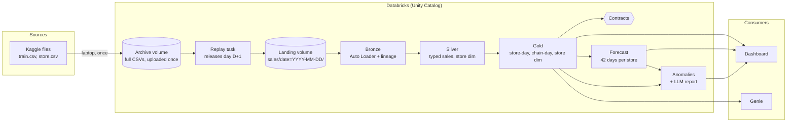

# Part V — Worked example: the reusable template on the Rossmann dataset

> Companion to the handbook (Chapters 1–11) and the template from Lab 10b.
> Question answered here: **can the same template and method build a similar end-to-end solution for retail sales (Rossmann)? Yes. Here's every step, from understanding the data to a monitored prod release.**

---

## Chapter 12 — Can the template handle Rossmann?

### 12.1 Short answer

**Yes. Rossmann is an almost ideal second dataset for the template**, because it has the same shape as the energy project: a **time series per entity** (sales per store per day instead of load per hour), a **dimension table** (stores instead of series metadata), **calendar effects** (German holidays, school holidays, promotions instead of DST and weekends), and a **forecasting** question.

| Template part (from Lab 10b) | Energy project | Rossmann | Reuse |
| --- | --- | --- | --- |
| Repo layout, `pyproject`, ruff, pytest, pre-commit | ✓ | ✓ | **100 %** |
| Bundle with dev/staging/prod, name prefixes, private root path | ✓ | ✓ | **100 %** (new project name, schemas `retail_*`) |
| CI/CD workflows, ruleset, approval-gated prod, service principals | ✓ | ✓ | **100 %** |
| Wheel packaging, contracts as package data | ✓ | ✓ | **100 %** |
| Contract framework (row_condition, unique, sql_check), CI breaking-change guard | ✓ | ✓ | **100 %** framework, **new** YAML content |
| Anomaly framework (robust z, Isolation Forest, severity, LLM summary) | ✓ | ✓ | **~80 %**: new "physics" rules |
| Forecast framework (baseline, MLflow, champion gate, batch scoring, accuracy) | ✓ | ✓ | **~60 %**: new features, horizon, metric |
| Dashboard-as-code routine + tests, Genie method | ✓ | ✓ | **100 %** method, **new** content |
| Extractor | SMARD/Open-Meteo APIs | Kaggle files (static) + **replay** | **New** |
| Bronze/silver/gold logic | hourly energy | daily store sales | **New** |

**Roughly 70–80 % reused, 20–30 % new**, exactly as Chapter 10.1 predicted.

### 12.2 The one real difference: a static dataset

SMARD publishes new data every day. **Rossmann is a historical file** (a Kaggle competition from 2015): it never changes. A daily pipeline on a static file would be pointless, because every run would do nothing.

**Solution: a replay feed.** We keep the full file as an archive and release it **one simulated day at a time** into the landing zone. Then every part of the template has real work to do: Auto Loader picks up new files, quality checks see a new day, the forecast is issued and later evaluated, anomalies appear when they happen.

```
archive (full train.csv, uploaded once)  →  replay task: "release day D+1"  →  landing/sales/date=D+1/  →  bronze → silver → gold …
```

Simulating a live feed from history is a standard technique (backtesting, demo environments), and it's a good interview topic in its own right: *"How do you test an incremental pipeline when you only have historical data?"*

### 12.3 What you'll practise that's *new* compared with energy

| New skill | Where |
| --- | --- |
| Joining a **fact** table with a **dimension** table (stores) and handling **slowly changing** attributes (competition opening, Promo2 start) | Lab 2 |
| A **feature that leaks** although it looks harmless (`Customers`) | Lab 7 |
| **Many series** (1,115 stores): one global model instead of one per series | Lab 7 |
| A business metric (**RMSPE**) and closed days (sales = 0 by definition) | Lab 7 |
| **Known data gaps** that are real, not errors (180 stores missing in 2014 H2) | Lab 8 |
| Replay as an ingestion pattern | Lab 1, 4 |

---

## Chapter 13 — Rossmann, step by step through all labs

Every lab below follows the **lifecycle from Chapter 3** (sync → branch → plan → build → test the test → local checks → dev → plausibility → PR → staging → release → prod → tutorial + tag). The lifecycle commands are identical, so they're not repeated in every lab; only what's *specific* to Rossmann is shown.

### Step 0 — Understand the data (before any code)

**Get the data:** Kaggle competition **"Rossmann Store Sales"**. You need a Kaggle account and must **accept the competition rules** on the website before downloading.

> **Licence:** competition data comes with the competition's rules, which may restrict redistribution. **Don't commit the raw CSVs to your public repo**, and don't publish the raw data. Read the *Rules* tab yourself before starting. Aggregated results, charts and your code are what the portfolio shows.

```powershell
# on the laptop, outside the repo
uv tool install kaggle
kaggle competitions download -c rossmann-store-sales -p C:\data\rossmann
Expand-Archive C:\data\rossmann\rossmann-store-sales.zip C:\data\rossmann
Get-ChildItem C:\data\rossmann
```

**Expected:** `train.csv`, `store.csv`, `test.csv`, `sample_submission.csv`.

**Profile it (Chapter 4 prompt, adapted):**

```text
Profile C:\data\rossmann\train.csv and store.csv with duckdb (don't load fully into pandas). Write
scripts/profile_rossmann.py that saves docs/data-profile.md with:
row counts; per column type, null %, distinct, min/max or top-5 values; duplicates on (Store, Date);
date range; rows per date (to find gaps); stores per date; first 20 / last 20 rows IN FILE ORDER and ordered by Date;
20 random rows; count of rows with Open=1 AND Sales=0, Open=0 AND Sales>0; distinct values of StateHoliday
(read as string); stores with missing dates and which date ranges. Don't modify data. Don't print more than 20 raw rows.
Then list 5 questions I should answer before designing silver and gold.
```

**The ten questions (my expected answers; confirm each with your profile):**

| # | Question | Rossmann answer |
| --- | --- | --- |
| 1 | Grain | One **store × day** (`train.csv`); one **store** (`store.csv`) |
| 2 | Key | `(Store, Date)`; check it's unique |
| 3 | Time column / zone | `Date`, a **local German date without time**, so no DST problem (unlike energy) |
| 4 | Units | `Sales` in currency per day (EUR), `Customers` = count per day |
| 5 | Freshness | **None: static history** (2013-01-01 to 2015-07-31) → replay |
| 6 | Late data / corrections | None in the file; the replay can **simulate** a correction (exercise) |
| 7 | Nulls | Mostly in `store.csv` (competition and Promo2 fields); `CompetitionDistance` has a few nulls |
| 8 | Plausible ranges | Sales ≥ 0; `Open = 0` ⇒ `Sales = 0`; typical open-day sales in the thousands per store; Sundays mostly closed |
| 9 | Size | About **1 million rows** for ~1,115 stores × ~940 days: small for Spark |
| 10 | Licence / privacy | Competition rules (see above); no personal data |

**Surprises the profile should reveal** (the reasons we profile instead of reading the first rows):

- **File order is newest first.** In my copy, the "first 200 rows" are the *last* day. Always order explicitly.
- **`StateHoliday` mixes `0` (number) and `"0"` (text)** plus `a`/`b`/`c` (public / Easter / Christmas). Read it as text.
- **A block of stores (about 180) has no rows for the second half of 2014.** That's a known gap in the data, not a pipeline bug. Your completeness check must know about it (Lab 8).
- **Some rows have `Open = 1` and `Sales = 0`** (a few dozen): probably data errors, a **critical** rule.
- **`Customers` is only known after the day is over**, so it can't be a forecast feature (Lab 7).

**Checkpoint:** `docs/data-profile.md` exists, and you can answer all ten questions without opening the CSV.

### Step 0b — Two-sentence story and both architectures

**Story:** *"Every day, the new day's store sales from 1,115 Rossmann stores arrive in the lakehouse (replayed from history). Databricks cleans and checks them, forecasts each store's sales for the next six weeks, flags suspicious days, and updates a dashboard and an AI assistant for regional managers."*



The **delivery architecture is unchanged** from Chapter 1.2 (branch → PR/CI → staging → release + approval → prod). That's the point of the template.

**Gold tables, named before building (work backwards from the users):**

| Gold table | Grain | Used by |
| --- | --- | --- |
| `gold_sales_store_daily` | store × day | dashboard, forecast features, anomalies |
| `gold_sales_chain_daily` | day | KPIs, Genie |
| `gold_store_dim` | store | dashboard filters, model features |
| `gold_forecast_store_daily` | issue date × store × target date | dashboard, accuracy |
| `gold_forecast_accuracy` | issue date | dashboard, drift monitor |
| `gold_dq_anomalies` | finding | dashboard, LLM report |

---

### Lab 0 — Create the project from the template

```powershell
cd C:\dev
uvx copier copy gh:tutul032/databricks-lakehouse-template retail-lakehouse-de
# answers: project_name=retail-lakehouse-de, package=retail_lakehouse, schema_prefix=retail,
#          host=<your workspace URL>, alert_email=<you>
cd retail-lakehouse-de
git init ; git add -A ; git commit -m "chore: project from template"
gh repo create retail-lakehouse-de --public --source . --push
uv sync ; uv run pre-commit install
uv run ruff check . ; uv run pytest -q
databricks bundle validate -t dev -p free
```

(Use the template name you choose in Lab 10b; `copier` is one option, a Databricks bundle template is the other.)

**Then, once:** schemas `retail_dev`, `retail_staging`, `retail_prod`, the shared raw zone `retail_raw.landing` + an `archive` volume, grants for the CI/CD and refresh service principals (copy the SQL from Lab 5, replace `energy` with `retail`), GitHub secrets/variables, environment `production`, ruleset on master.

> **Reuse the existing service principals** (`sp-energy-cicd`, `sp-energy-refresh`) only if you're happy with one identity for both projects. Cleaner: one pair per project. Never copy a secret into a file or chat; create a new one and put it straight into GitHub secrets.

**Checkpoint:** CI green on the first PR; `bundle validate` OK for all three targets; the template's guard tests pass (no placeholders left, no secrets, environments defined).

---

### Lab 1 — Ingestion: archive upload + replay

**Prompt:**

```text
Read CLAUDE.md first. Add Rossmann ingestion. Do not deploy.
1. scripts/upload_archive.py (laptop, one-off): uploads train.csv and store.csv unchanged to
   /Volumes/workspace/retail_raw/archive/rossmann/ with `databricks fs cp`, verifies size after upload, fails loudly.
2. src/retail_lakehouse/replay.py (pure, Spark-free core + thin Spark wrapper):
   - next_dates(last_released: date | None, days_per_run: int, first_date: date, last_date: date) -> list[date]
   - release(day) writes the rows of that Date from the archive to
     /Volumes/workspace/retail_raw/landing/sales/date=YYYY-MM-DD/sales.csv, header included, never overwrites an
     existing file (idempotent), and returns {written, skipped}.
   - the simulated clock = max(date=...) folder in landing (no separate state store).
   - store.csv is copied once to landing/stores/snapshot=YYYY-MM-DD/stores.csv.
3. src/notebooks/replay_day.py: job task with job parameters days_per_run (default 1) and initial_until (default
   2015-03-31, used only when landing is empty: releases all days up to that date).
4. Tests (offline): next_dates on empty landing, mid-way, at the end (returns []), days_per_run=7;
   release is idempotent (second call: written 0, skipped 1).
Handback: changed files + checkpoint commands.
```

**Why `initial_until = 2015-03-31`:** the first run releases ~27 months of history at once (enough for training), and the remaining ~4 months come **one day per run**, so forecasts can be issued and evaluated over time. For a faster demo, use `days_per_run = 7`.

**Checkpoint:**

```sql
SELECT count(*) AS files FROM read_files('/Volumes/workspace/retail_raw/landing/sales/', format => 'csv', header => true);
-- rerun the replay task with days_per_run=1, then:
SELECT max(Date) FROM read_files('/Volumes/workspace/retail_raw/landing/sales/', format => 'csv', header => true);
```

**Expected:** after the first run, all rows up to 2015-03-31; after each further run, `max(Date)` moves forward by exactly one day. Running the same day twice writes nothing.

**Typical errors:** `StateHoliday` inferred as integer and the `a/b/c` rows becoming NULL (always set an explicit schema); dates parsed as text.

---

### Lab 2 — Medallion pipeline

**Prompt:**

```text
Add the Lakeflow declarative pipeline for Rossmann (pure helpers unit-tested):
- bronze_sales (streaming, Auto Loader csv, header, EXPLICIT schema with StateHoliday STRING, lineage columns
  _source_file, _ingested_at; cloudFiles.partitionColumns "")
- bronze_stores (streaming, same pattern)
- silver_sales (MV): typed columns (store_id INT, date DATE, sales DOUBLE, customers INT, is_open BOOLEAN,
  promo BOOLEAN, state_holiday STRING mapped 0/a/b/c -> none/public/easter/christmas, school_holiday BOOLEAN);
  dedupe on (store_id, date) newest _source_file wins; null-safe expectations:
  valid_store (store_id IS NOT NULL), non_negative_sales (sales IS NULL OR sales >= 0),
  closed_means_zero (is_open OR coalesce(sales,0) = 0) as WARN.
- silver_stores (MV): latest snapshot; competition_open_since as a DATE (from month/year, NULL if unknown);
  promo2_since as the Monday of (year, week); promo_interval as an array of month numbers.
- gold_sales_store_daily: silver_sales JOIN silver_stores plus derived columns: day_of_week, is_weekend,
  competition_active (date >= competition_open_since), promo2_active (promo2 started AND month in promo_interval),
  sales_per_customer (NULL if customers = 0).
- gold_sales_chain_daily: per date: total_sales, open_stores, reporting_stores, avg_sales_per_open_store,
  promo_share, expected_stores, is_complete (reporting_stores = expected_stores).
- gold_store_dim from silver_stores.
Do not deploy.
```

**What's new vs. energy:** the **dimension join** and **time-dependent attributes**. *"Is competition active?"* isn't a store attribute; it depends on the **date** (the competitor opened at some point). Same for Promo2. Computing it **per row in gold** is the clean way; that's a typical interview question on slowly changing dimensions.

**Checkpoint (plausibility SQL):**

```sql
-- counts per layer
SELECT 'bronze' l, count(*) FROM retail_dev.bronze_sales UNION ALL
SELECT 'silver', count(*) FROM retail_dev.silver_sales UNION ALL
SELECT 'gold',   count(*) FROM retail_dev.gold_sales_store_daily;
-- key unique
SELECT store_id, date, count(*) FROM retail_dev.silver_sales GROUP BY 1, 2 HAVING count(*) > 1;
-- business rules
SELECT count_if(NOT is_open AND sales > 0) AS closed_with_sales,
       count_if(is_open AND sales = 0)     AS open_without_sales FROM retail_dev.silver_sales;
-- reporting stores per day: expect ~1,115, and ~935 in 2014 H2
SELECT date, reporting_stores, open_stores FROM retail_dev.gold_sales_chain_daily ORDER BY date DESC LIMIT 14;
```

**Expected:** bronze = silver = gold row counts (no duplicates in Rossmann); `closed_with_sales = 0`; `open_without_sales` = a few dozen; Sundays show far fewer open stores.

**Incrementality proof** (as in Lab 2): run the pipeline twice without a new replay day → bronze writes 0 rows.

---

### Lab 3 — A second source

Energy added weather. For retail, pick **one** of these (all public, check each licence):

| Option | Why it matters for sales | Join key |
| --- | --- | --- |
| **German public & school holiday calendar** per state | Holidays differ by Bundesland | store → state (needs a store-to-state mapping) |
| **Weather** (Open-Meteo history) per state capital | Rain and heat change footfall | state + date |
| **Google Trends**-style search interest | Brand interest over time | date (+ state) |

The **template's Open-Meteo extractor is reused unchanged** (Lab 3), only with new coordinates and daily instead of hourly variables. The store-to-state mapping isn't in the official files; community-created mappings exist on Kaggle. If you use one, **cite it and treat it as uncertain** (add a contract rule: every store has exactly one state).

**Checkpoint:** `gold_sales_store_daily` has weather for almost every row; a small analysis query shows a plausible effect (e.g. sales on rainy Saturdays vs. dry Saturdays per store type).

---

### Lab 4 — Daily refresh (replay instead of extraction)

The big simplification: **no internet access is needed** (the archive is already in a volume), so the whole daily refresh can be **one Databricks job with a schedule**. No GitHub Actions extract step.

```
replay_day → run_pipeline → quality_checks → apply_contracts → verify_contracts
           → score_forecast → forecast_accuracy → detect_anomalies → dq_summary_llm (ALL_DONE)
```

- Schedule: daily (one simulated day per real day), or every few hours for a faster demo.
- The **replay task runs only in prod**; dev and staging read the same shared landing zone (the shared raw zone principle from Lab 5) and only run the pipeline + checks.
- Keep `max_concurrent_runs: 1` and queueing: two replay runs at once would release the same day twice (the idempotent writer protects you, but don't rely on that).

**`quality_checks` for retail:** newest date in silver = the simulated clock; yesterday has ≥ 1,000 reporting stores (or the known-gap count); `closed_with_sales = 0`.

**Checkpoint:** three scheduled runs in a row, each advancing the clock by one day, all green; a deliberately failing check (e.g. expect 2,000 stores) sends the email.

---

### Lab 5 — CI/CD

**Nothing to build:** it comes from the template. Do the **proof runs** anyway, because they prove the template works for a new project:

1. A direct push to master is rejected.
2. A PR runs CI (ruff, pytest, `bundle validate` staging/prod).
3. Merge → staging deploys and runs.
4. `gh release create v0.1.0` → approval → prod deploys as the service principal.

**Checkpoint:** `[staging]` and `[prod]` resources exist and are owned by the CI/CD service principal.

---

### Lab 6 — Data contracts

Example contract (ODCS-style, as in Lab 6):

```yaml
# contracts/gold_sales_store_daily.yaml
id: gold_sales_store_daily
version: 1.0.0
owner: retail-data-team
description: One row per store and calendar day; sales in EUR (local German date).
schema:
  - { name: store_id,  type: int,     required: true }
  - { name: date,      type: date,    required: true }
  - { name: sales,     type: double,  required: true,  unit: EUR/day }
  - { name: is_open,   type: boolean, required: true }
  - { name: promo,     type: boolean, required: true }
  - { name: competition_active, type: boolean, required: true }
quality:
  - { type: unique, columns: [store_id, date] }
  - { type: row_condition, name: non_negative_sales, condition: "sales >= 0" }
  - { type: row_condition, name: closed_means_zero, condition: "is_open OR sales = 0" }
  - type: sql_check
    name: chain_total_matches_stores
    query: >
      SELECT count(*) AS violations FROM {catalog}.{schema}.gold_sales_chain_daily c
      JOIN (SELECT date, sum(sales) s FROM {catalog}.{schema}.gold_sales_store_daily GROUP BY 1) d USING (date)
      WHERE abs(c.total_sales - d.s) > 0.001 * greatest(d.s, 1)
sla:
  freshness: "newest date = simulated clock"
consumers: [retail-dashboard, retail-genie, forecast]
```

**Proof (test the test):** rename `sales` → `revenue` in `transforms.py` → CI fails with the breaking-change guard; set the SLA to an impossible value → `verify_contracts` fails in dev with an email.

---

### Lab 7 — Forecast: six weeks per store

**The problem:** at the end of each simulated day, forecast **daily sales for each store for the next 42 days** (the Kaggle task used about six weeks).

**Leakage, the Rossmann way:**

| Column | Known at issue time? | Use as feature? |
| --- | --- | --- |
| `DayOfWeek`, date parts, holidays, `SchoolHoliday` | Yes (calendar) | ✓ |
| `Promo` | Yes: promotions are **planned** in advance | ✓ |
| `Open` | Yes: opening days are planned | ✓ (and predict 0 when closed) |
| Store attributes, `competition_active`, `promo2_active` | Yes, computable for future dates | ✓ |
| **`Customers`** | **No:** only known after the day | ✗ **leak** |
| Sales lags < 42 days | Not for the far end of the horizon | Only lags ≥ issue date (see below) |

**Guard:** a test that fails if `customers` or any column derived from it appears in the feature list. (Same idea as `LeakageError` in Lab 7.)

**Lag features without leakage:** compute per-store statistics **as of the issue date** (e.g. mean sales per store × day-of-week × promo over the 8 weeks **before** the issue date) and attach them to all 42 target days. Every target day then uses only information available at issue time, whatever its distance.

**Baseline:** for each store × day-of-week × promo, the **median sales over the last 8 weeks** before the issue date (0 if closed).

**Model:** **one global model** for all stores (HistGradientBoosting or LightGBM), target `log1p(sales)`, trained on open days only. A model per store would mean 1,115 models: hard to monitor, and small stores have little data. Store attributes and the per-store statistics let one model learn store differences.

**Metric:** **RMSPE** over open days with sales > 0 (the competition metric: root of the mean squared *percentage* error), plus MAE for the dashboard. Champion gate: the new model's RMSPE must beat the baseline's on the last 6 weeks of training data (time split, never shuffled).

**Prompt (short):**

```text
Add the forecast to retail_lakehouse following CLAUDE.md and the energy project's design:
features.py (issue-date-aware, 42-day horizon, NO customers: test that fails if it appears), baseline.py
(median store x dow x promo, 8 weeks), train.py (global HistGradientBoostingRegressor on log1p(sales), open days only,
time split: last 42 days as validation), metric rmspe(), MLflow logging, UC model forecaster_sales with
@champion only if rmspe < baseline_rmspe; score.py writes gold_forecast_store_daily (issue_date, store_id,
target_date, forecast, model_version), 0 for planned-closed days; accuracy.py writes gold_forecast_accuracy
for issue dates whose 42 days are all released (is_final) and a running version for partial windows.
Train and score use the same job environment (the wheel).
```

**Checkpoint:**

```sql
SELECT issue_date, count(*) AS rows, count(DISTINCT store_id) AS stores, min(target_date), max(target_date)
FROM retail_prod.gold_forecast_store_daily
WHERE issue_date = (SELECT max(issue_date) FROM retail_prod.gold_forecast_store_daily) GROUP BY issue_date;
```

**Expected:** 42 target dates, about 1,115 stores, so roughly 46,800 rows per issue date. The model's RMSPE clearly below the baseline's (write down your own numbers; don't copy published Kaggle scores, which used a different setup).

**Interview line:** *"The most tempting feature, the number of customers, is a leak: it's only known after the day. A test makes it impossible to use."*

---

### Lab 8 — ML-assisted data quality

**Severity design for retail** (the same principle: *unusual ≠ broken*):

| Check | Kind | Severity | Why |
| --- | --- | --- | --- |
| `is_open AND sales = 0` | Physics rule | **critical** | An open store with zero sales is almost certainly a data error |
| `NOT is_open AND sales > 0` | Physics rule | **critical** | Impossible |
| Duplicate `(store_id, date)` | Structure | **critical** | Breaks every sum |
| Reporting stores < expected | Completeness | **critical**, except the **documented 2014 H2 gap** | Missing data |
| Sales robust z per store × dow × promo (median/MAD) | Statistical | **warning** | Could be a real event (refurbishment re-opening, local festival) |
| Isolation Forest on (sales, customers, sales per customer) | ML | **warning** | Unusual combinations |
| `sales_per_customer` outside the store's normal range | Statistical | **warning** | Data entry error or real basket change |
| Forecast RMSPE worse than baseline 3 days in a row | Drift (monitor) | **warning** → review | Model aging |

**The known gap is the lesson here.** Your first run will find ~180 stores "missing" for six months. That's exactly the 28-critical moment from the energy project: **investigate before reacting.** It's a property of the dataset, so encode it as an **expected exception** (a small `expected_store_gaps` reference table, part of the contract), not as a lower threshold for everyone.

**Injected anomaly (proof):** add a `TEST:` row with an open store and sales = 0 → it appears as critical in `gold_dq_anomalies`, the report mentions it, and TEST rows are excluded from the dashboard and Genie.

**LLM summary:** same `ai_query` task and prompt structure as energy, with retail wording: *"Summarise today's findings for a regional sales manager in five bullet points; separate likely data errors from unusual but real business events."*

---

### Lab 9 — Dashboard and Genie

**Pages** (same routine: datasets with unqualified names → widgets → export → restore YAML → tests):

| Page | Widgets |
| --- | --- |
| **Overview** | Counters: total sales (latest complete day), open stores, avg sales per open store; 8-week trend of chain sales |
| **Promotions** | Promo uplift by store type and assortment: avg sales with vs. without promo, same weekday |
| **Stores** | Top/bottom 10 stores (last 28 days), sales vs. competition distance (scatter), store type mix |
| **Forecast** | Chain forecast for the next 42 days vs. last year same weekday; forecast vs. actual; accuracy table (RMSPE model vs. baseline) |
| **Data quality** | Findings per day by severity, top findings, LLM report, freshness (simulated clock) |

**Plausibility checks before trusting the KPIs** (the 596-GWh lesson): the chain total for an open weekday should be in the same order of magnitude as stores × typical store sales; Sunday totals must be far lower; promo days higher.

**Genie instructions (example):**

```text
Rossmann store sales (Kaggle competition data, replayed daily). Dates are local German calendar dates.
- "Today" = the simulated clock: max(date) in gold_sales_chain_daily. "Yesterday" = the day before that.
- Use only complete days (is_complete = true) for chain totals.
- sales is EUR per store per day; closed days have sales 0 and must be excluded from averages per store
  (filter is_open = true).
- Promo uplift = avg sales on promo days minus avg sales on non-promo days, same store and same day of week.
- Forecasts: gold_forecast_store_daily; the latest forecast is max(issue_date). Accuracy: gold_forecast_accuracy
  (rmspe vs baseline_rmspe); lower is better.
- Data quality: gold_dq_anomalies; 'critical' = likely data error, 'warning' = unusual but possibly real;
  ignore entities starting with 'TEST:'.
- Round money to whole EUR.
```

**Benchmarks (write the expected SQL yourself first):**
1. What were total sales yesterday, and how many stores were open?
2. Which store type has the highest average sales per open day in the last 4 weeks?
3. How large is the promo uplift for store type `a` (percent)?
4. Which 5 stores had the highest sales last week?
5. What is the forecast for store 1 next Monday?
6. Were there any critical data-quality findings this week?

---

### Lab 10 — Packaging, docs, release

From the template: the wheel, the release workflow, the README structure, the ADR and runbook skeletons. **New content only:**

- README pitch: *"Retail sales lakehouse on Databricks: 1,115 stores replayed daily, six-week forecasts per store with a leakage-safe global model, data contracts, ML-assisted data quality and an AI/BI dashboard with Genie."*
- Results with **your** numbers (RMSPE model vs. baseline, promo uplift, critical findings in prod).
- ADRs specific to retail: *replay instead of live extraction*; *one global model instead of per-store models*; *Customers excluded as a leaking feature*; *known data gaps as contract exceptions*.
- Known limitations: historical data from 2013–2015; store-to-state mapping from a community source (if used); a simulated clock.
- A licence note: raw data isn't redistributed; download from Kaggle under its rules.

**Checkpoint:** `v1.0.0` released after the docs PR is merged; README with hero image, results, screenshots; pinned with topics `retail`, `forecasting`, `databricks`, `mlops`.

---

## Chapter 14 — Effort, priorities and what to say in interviews

### 14.1 How long it should take

| Situation | Effort |
| --- | --- |
| Energy project from scratch (Labs 0–10) | ~4 weeks including learning |
| Rossmann **with** the template | **~1–2 weeks**: most time goes to Step 0, Lab 2 (dimension logic), Lab 7 (features) and Lab 9 (content) |
| Rossmann thin slice only (Step 0 → Labs 0–2 → one dashboard page → prod) | **~2 days**: the best **test of the template** in Lab 10b |

### 14.2 Recommended use in your plan

Rossmann is the **ideal acceptance test for the template (Lab 10b)**: if a thin slice of Rossmann reaches prod in about two days without editing template files, the template works. It also adds the **retail** sector to a portfolio that already shows energy (Project 1), and will show finance (Project 2, PaySim) and compliance GenAI (Project 3). That's three or four sectors with one consistent engineering method, which is a strong story when applying across industries.

Whether you take Rossmann to the full Lab 10 depends on time: the thin slice proves the template; the full build (especially Labs 7–8) adds a second forecasting case with a different leakage trap.

### 14.3 Interview-ready summary

*"I extracted the patterns from my energy lakehouse into a project template (bundle with three environments, CI/CD with approval-gated prod, contracts with a CI guard, anomaly severity framework, dashboard-as-code tests) and validated it on a different domain: Rossmann retail sales. Because the dataset is historical, I built a replay feed that releases one day per run, so the incremental pipeline, quality gates and forecast evaluation behave as in production. The forecast is a global gradient-boosting model for 1,115 stores with a six-week horizon; the most tempting feature, customer count, is a leak, and a test blocks it. About 75 % of the code came from the template; the new work was the domain logic."*

### Exam questions — Part V

1. **Why is a replay feed needed for Rossmann, and what does it make testable?**
   *Answer:* the data is static; replaying one day per run gives Auto Loader new files, gates a new day to check, and forecasts something to be evaluated against later.
2. **Why is `Customers` a leak?**
   *Answer:* it's only known after the day ends, so it's unavailable when a forecast is issued.
3. **Why compute `competition_active` per row instead of storing it in the store dimension?**
   *Answer:* it depends on the date; the same store has no competitor before the opening date and one after.
4. **Why one global model instead of 1,115 store models?**
   *Answer:* shared patterns, more data per model, one thing to monitor and promote; store attributes and per-store statistics capture differences.
5. **The completeness check reports 180 stores missing for six months. What do you do?**
   *Answer:* investigate first; it's a known property of the dataset, so document it as an expected exception in the contract instead of lowering the threshold for all stores.
6. **Which energy-project lesson does "file order is newest first" repeat?**
   *Answer:* never judge data by its first rows; always order explicitly and look at both ends.
7. **Which template parts did not change at all?**
   *Answer:* repo layout, bundle targets, CI/CD workflows, service principal setup, wheel packaging, contract and anomaly frameworks, dashboard-as-code routine and tests.

**Exercise 14.1:** build the Rossmann thin slice (Step 0 → Labs 0–2 → the Overview page) from your template and record every template file you had to edit. Each edit is a template improvement.

**Exercise 14.2:** make the replay simulate a **correction**: re-release a past day with changed sales for 3 stores, and prove that "newest file wins" in silver picks up the correction and the forecast accuracy is recomputed.
